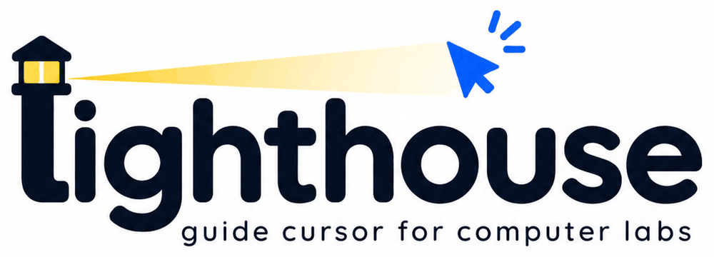
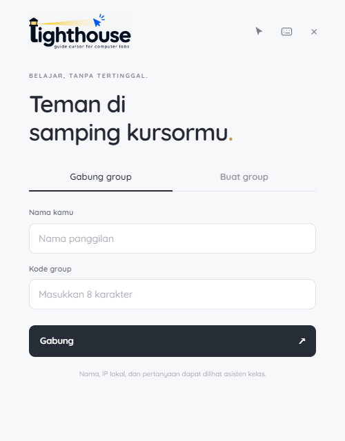
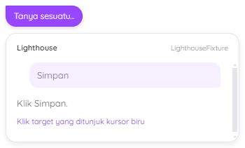

<p align="center"></p>

# Lighthouse Desktop 🔦

A small lab companion that turns an assistant's demonstration into guidance on a student's own screen.

[Download for Windows](https://github.com/LightHoouse/LightHouse-App/releases/latest) · [Backend](https://github.com/LightHoouse/LightHosue-Backend) · [AI service](https://github.com/LightHoouse/LightHouse-AI)

## See it in action

<p align="center"></p>
<p align="center"><em>Students join a class with a short group code.</em></p>

<p align="center"></p>
<p align="center"><em>Questions open beside the cursor and stream a grounded answer from the class recording.</em></p>
## Use it

1. **Assistant:** enter your name, create a group, and share its code.
2. Click **Record** on the floating toolbar, then demonstrate across your applications.
3. Use **Pause / Resume** as needed, then **Stop** to end the session. Steps sync automatically, without per-step save dialogs. No manual step notes are needed.
4. **Student:** join with your name and the group code. Lighthouse stays beside your cursor.
5. Press **Alt+L** to open a small purple input beside your mouse. It grows with the text; **Enter** sends and **Escape** closes. Answers stream into a compact card after you ask. Ask a question; Lighthouse uses the active application and the latest group recording to point at a matching control with the blue companion. You perform the action yourself.

No MQTT, database, or AI credentials are needed in the installer. HTTPS connects to `lighthouse-be.yanzz.dev`; the backend owns group membership and AI access. Student questions and visible control names are sent to the service. Typed contents and password fields are not recorded. Membership and pending recordings are encrypted locally with a durable Windows DPAPI-protected profile key. Groups expire after seven days.

## What works

- Create/join groups with assistant and student roles; assistants can disable questions for assessments.
- Native Windows UI Automation recording of accessible targets, mouse clicks, typing events without text, and scroll events.
- Sequential guidance and AI selection from the group's recorded steps.
- Live target resolution by AutomationId or control type/name, including relocated windows.
- Explicit failure for ambiguous or missing targets; the click-through companion never takes control of input.
- Source and packaged two-client E2E tests against a real MongoDB test instance and a separate native Windows target.

This is a Windows prototype. Custom-drawn controls, elevated apps, complex menus, and browser DOM locators are not covered. The app does not execute actions or infer overall task completion. After a target click it compares observed UI changes where evidence exists; otherwise the result is unverifiable. Pending recordings survive process restarts and resume paused. A pending Stop is retried after uploads finish. The installer is unsigned.

## Development

Requires Windows x64, Node.js 22+, and the .NET Framework 4.x compiler/UI Automation assemblies included with supported Windows installations.

```powershell
npm ci
npm run dev
```

The build compiles `native/Bridge.cs` into a helper shipped alongside Electron. The UI runs in a sandboxed renderer; API credentials and native process control stay in the main process.

Optional process configuration: `LIGHTHOUSE_BACKEND_URL` selects an HTTPS backend (localhost HTTP is allowed for development). `LIGHTHOUSE_PROFILE_DIR` gives a separate encrypted membership profile, useful for testing two clients on one machine.

## Verification

Clone the backend beside this repo, install its dependencies, and build it first. Tests start an isolated MongoDB instance and backend; they never need production credentials.

```powershell
npm --prefix ../backend ci
npm --prefix ../backend run build
npm test
npm run package
$env:LIGHTHOUSE_TEST_EXE = "$pwd/release/win-unpacked/Lighthouse.exe"
npx playwright test
```

Set `LIGHTHOUSE_E2E_BACKEND_DIR` if the backend checkout is elsewhere. `LIGHTHOUSE_E2E_URL` explicitly selects a deployed backend for a live AI E2E trial. The test creates and closes its own group. Native input tests temporarily use the desktop, so avoid interacting during the test.

## Releases

Push a `vX.Y.Z` tag matching `package.json` after adding `docs/releases/X.Y.Z.md`. CI checks the source, records and resolves real native controls with two clients, packages the app, and repeats the test against the packaged executable. Only that tested installer is published, with `release-manifest.json` and `SHA256SUMS.txt`. Branch builds create artifacts without publishing releases. There is no automatic updater yet.

Typography uses bundled [Quicksand](https://fonts.google.com/specimen/Quicksand), licensed under the [SIL Open Font License](src/ui/fonts/Quicksand-OFL.txt). Cursor styling is inspired by [Clicky](https://github.com/farzaa/clicky).

### Extended desktop trial

The opt-in long scenario exercises 120 native input actions across two applications, three pause/resume cycles, database ordering and redaction, repeated questions, encrypted membership after restarting the student client, unavailable controls, disabled questions, a second recording, and group closure. It creates its own group and closes it afterward. Run it against a configured live backend to test real AI streaming; it uses the desktop for native input.

```powershell
$env:LIGHTHOUSE_LONG_E2E = '1'
$env:LIGHTHOUSE_E2E_URL = 'https://lighthouse-be.yanzz.dev'
# Optional: target an already-packaged executable instead of source.
$env:LIGHTHOUSE_TEST_EXE = "$pwd/release-0.2.2/win-unpacked/Lighthouse.exe"
npx playwright test
```

Results are written to `test-results/long-session-report.json`; screenshots accompany each completed question. Normal CI continues to run the isolated smoke scenario. These tests cover native accessible test controls, not every third-party application's canvas.

The chat bubble follows your mouse while open. The answer card flips above the input near the bottom edge and shifts left near the right edge. After an answer, the blue companion travels to the resolved control; your real pointer stays under your control. Use Enter to send and Escape to dismiss.

For the optional Windows Calculator test, open Calculator, set `LIGHTHOUSE_REAL_E2E=1` and `LIGHTHOUSE_E2E_URL`, then run `npm test`. Use an empty Calculator session; the test enters 7 + 8.

## Local classroom tools

Open **Kelola kelas** from the group panel to see students with their reported local IP, then select a person for their question history (latest 200 questions per class). A device ID distinguishes devices when IPs change. Only assistants receive device/IP metadata. The assistant's laptop keeps an encrypted cache for offline reading; new questions still require the server. Students see a notice that the assistant can read their name, local IP and questions. Stop opens the session summary automatically.

**Stop** automatically writes a `.lighthouse` JSON recording to `Documents/Lighthouse/Recordings`. Use **Folder rekaman** to find it. Copy the file to another laptop, create a group as an assistant, and choose **Impor rekaman**. Import validates the version and every action, generates new event IDs, and uploads a new session to the current group. Files contain accessible target context and observed states; they contain no membership token, API credential or typed input contents. Treat app labels and window titles in a shared file as classroom data. If offline, the file is still saved and upload/Stop completes on reconnect. Importing into a group needs connectivity.

Recordings include scroll direction/delta and drag start/end and sampled path normalized to an accessible target, plus modifiers and supported command shortcuts. The blue companion animates the recorded path on the student's live target, without moving their real pointer. Scroll is acknowledged only inside the target in the recorded direction; drag requires a matching press/release near both endpoints. Canvas targets must expose a unique UI Automation identity; arbitrary Figma canvases, changed zoom/pan or layouts are not certified. The format stores target-relative points, not portable document object coordinates.

| Shortcut | Action |
| --- | --- |
| Alt+L | Student chat |
| Alt+G | Group / classroom panel |
| Alt+H | Hide panel and guidance |
| Alt+Shift+K | Shortcut page |
| Alt+Shift+R | Assistant record / pause / resume |
| Alt+Shift+S | Assistant stop and save |
| Alt+Shift+O | Assistant recording folder |
| Enter / Esc | Send question / close chat |

The shortcut page reports registration conflicts. Shortcuts do not execute actions in the student's application.

See [action coverage](docs/action-coverage.md) for the tested gesture model and application-specific limits. Classroom layout references: [Steep](https://mobbin.com/screens/88db9a18-c55d-4103-924b-6bb77ff067e9) and [Hashnode](https://mobbin.com/screens/8e2f4a34-2689-4461-aae2-e0032539b387) via Mobbin.

### Windows file icons and opening recordings

Installing version 0.3.2 or later registers `.lighthouse` as **Lighthouse Recording** with the Lighthouse icon. Double-click opens a preview, then an assistant can add it to their current class. No file is uploaded until import is confirmed. If Windows has a previous default association, choose **Open with > Lighthouse**. Unpacked development builds do not register file icons.

Import preview reference: [Podia on Mobbin](https://mobbin.com/screens/0f4b44b3-bcb0-4c19-80c9-414a89581eab).
